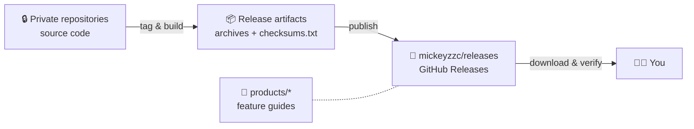

<div align="center">

# 📦 releases · 发布会

**The public release stage for projects developed in private repositories.**
Ready-to-run binaries, SHA-256 checksums and feature guides — the source code stays private.

[English](README.md) · [简体中文](README.zh-CN.md)


</div>

---

> The name is an English take on **发布会** — a launch event. Every time a privately developed project ships, it takes the stage here.

## What this repository is

Some projects are developed in private repositories. This repository is where their **compiled releases are published for everyone**:

- 📦 **Binaries** — every version is a [GitHub Release](https://github.com/mickeyzzc/releases/releases) with one archive per platform.
- 🔐 **Checksums** — every release ships a `checksums.txt` (SHA-256), so you can verify exactly what you downloaded.
- 📖 **Feature guides** — every listed product has a public introduction under [`products/`](products/).

What it is **not**: this repository contains **no source code**. The "Source code (zip / tar.gz)" archives that GitHub attaches to every release automatically contain only these docs.

## How it works



## Product catalog

> 🚧 **No products listed yet.** Each product gets a row here — and a guide under [`products/`](products/) — when its first release launches.

<!-- Catalog template — uncomment when the first product launches:
| Product | What it does | Platforms | License | Downloads |
|---|---|---|---|---|
| 🧩 **[Name](products/<product>/README.md)** | One-line description | Linux amd64 · arm64 | License | [Releases](https://github.com/mickeyzzc/releases/releases?q=<product>) |
-->

## Downloading

1. Open **[Releases](https://github.com/mickeyzzc/releases/releases)** and find your product — every tag starts with the product name (`<product>-vX.Y.Z`), so typing it into the search box filters the list.
2. Download the archive for your OS / CPU architecture, plus `checksums.txt`.
3. Verify the checksum (below), extract, and follow the *Quick start* in the product guide.

### Verify your download

```bash
# Linux
sha256sum -c checksums.txt --ignore-missing
# macOS
shasum -a 256 -c checksums.txt --ignore-missing
```

```powershell
# Windows (PowerShell) — compare the hash with the matching line in checksums.txt
Get-FileHash .\<file>.zip -Algorithm SHA256
```

A mismatch means the file is corrupted or is not the one published here — do not run it.

## Conventions

| Item | Format | Example |
|---|---|---|
| Tag | `<product>-v<semver>` | `<product>-v1.4.0` |
| Release title | `<Product> v<semver>` | `<Product> v1.4.0` |
| Archives | `<name>_<os>_<arch>.tar.gz` (`.zip` on Windows) | `<name>_linux_arm64.tar.gz` |
| Checksums | `checksums.txt` — SHA-256, one line per file | `<sha256>  <name>_linux_arm64.tar.gz` |
| Pre-releases | semver suffix `-alpha.N` / `-beta.N` / `-rc.N`, flagged *Pre-release* | `<product>-v2.0.0-rc.1` |

Because several products share this repository, GitHub's **"Latest"** badge only marks the most recent launch — not necessarily the newest version of *your* product. Always pick the newest release that carries your product's prefix.

## Feedback & security

- **Bugs and questions:** open an [issue](https://github.com/mickeyzzc/releases/issues/new/choose) with the product, release tag and your OS / architecture, plus the relevant log lines — **never paste passwords, tokens or private addresses**.
- **Security vulnerabilities:** report them privately via **[Security → Report a vulnerability](https://github.com/mickeyzzc/releases/security/advisories/new)**, not in a public issue.

## For maintainers

Publishing workflow and rules: [RELEASING.md](RELEASING.md) · helper script: [`scripts/publish.sh`](scripts/publish.sh) · product guide template: [`products/TEMPLATE.md`](products/TEMPLATE.md).

## License

This repository holds documentation and release tooling only. Each product is distributed under its own license — stated in its guide and in the license file shipped with every release.

Maintained by [@mickeyzzc](https://github.com/mickeyzzc).
