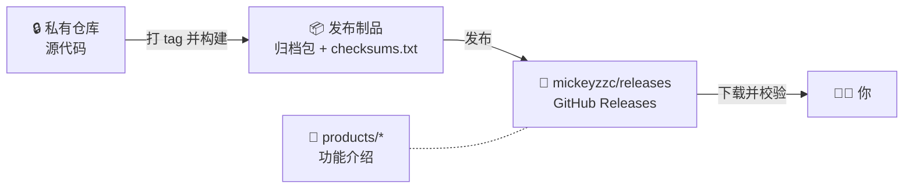

<div align="center">

# 📦 releases · 发布会

**私有仓库项目的公开发布台。**
开箱即用的二进制、SHA-256 校验文件与功能介绍——源码保持私有。

[English](README.md) · [简体中文](README.zh-CN.md)


</div>

---

> 仓库名取自 **「发布会」**：私有仓里开发的项目，每一次发版都在这里登台亮相。

## 这是什么仓库

有些项目在私有仓库中开发。本仓库负责把它们的**编译产物公开发布给所有人**：

- 📦 **二进制**：每个版本都是一个 [GitHub Release](https://github.com/mickeyzzc/releases/releases)，按平台各提供一个归档包。
- 🔐 **校验**：每个 Release 附带 `checksums.txt`（SHA-256），下载后可自行核验。
- 📖 **功能介绍**：每个上架的产品在 [`products/`](products/) 下都有一份公开的功能介绍。

本仓库**不包含任何源码**。GitHub 在每个 Release 自动附带的 “Source code (zip / tar.gz)” 压缩包里只有这些文档。

## 运作方式



## 产品目录

> 🚧 **暂无上架产品。** 产品首个版本发布时，会在这里新增一行，并在 [`products/`](products/) 下附上功能介绍。

<!-- 目录表模板——首个产品上架时取消注释：
| 产品 | 简介 | 平台 | 许可证 | 下载 |
|---|---|---|---|---|
| 🧩 **[名称](products/<product>/README.zh-CN.md)** | 一句话简介 | Linux amd64 · arm64 | 许可证 | [Releases](https://github.com/mickeyzzc/releases/releases?q=<product>) |
-->

## 下载

1. 打开 **[Releases](https://github.com/mickeyzzc/releases/releases)** 找到对应产品——每个 tag 都以产品名开头（`<product>-vX.Y.Z`），在搜索框输入产品名即可筛选。
2. 下载与你的系统 / CPU 架构匹配的归档包，以及 `checksums.txt`。
3. 校验（见下）后解压，按产品介绍里的「快速上手」运行。

### 校验下载

```bash
# Linux
sha256sum -c checksums.txt --ignore-missing
# macOS
shasum -a 256 -c checksums.txt --ignore-missing
```

```powershell
# Windows（PowerShell）——把输出的哈希与 checksums.txt 中对应行比对
Get-FileHash .\<file>.zip -Algorithm SHA256
```

哈希不一致说明文件已损坏或并非本仓库发布的文件——请勿运行。

## 命名约定

| 项目 | 格式 | 示例 |
|---|---|---|
| Tag | `<product>-v<semver>` | `<product>-v1.4.0` |
| Release 标题 | `<Product> v<semver>` | `<Product> v1.4.0` |
| 归档包 | `<name>_<os>_<arch>.tar.gz`（Windows 为 `.zip`） | `<name>_linux_arm64.tar.gz` |
| 校验文件 | `checksums.txt`：SHA-256，每个文件一行 | `<sha256>  <name>_linux_arm64.tar.gz` |
| 预发布 | semver 后缀 `-alpha.N` / `-beta.N` / `-rc.N`，标记为 *Pre-release* | `<product>-v2.0.0-rc.1` |

多个产品共用本仓库，因此 GitHub 的 **“Latest”** 标签只代表“最近一次发布”，不一定是*你所用产品*的最新版。请以带有该产品前缀的最新 Release 为准。

## 反馈与安全

- **问题反馈**：提交 [issue](https://github.com/mickeyzzc/releases/issues/new/choose)，写明产品、Release tag、系统 / 架构并附相关日志——**切勿粘贴密码、令牌或内网地址**。
- **安全漏洞**：请通过 **[Security → Report a vulnerability](https://github.com/mickeyzzc/releases/security/advisories/new)** 私下报告，不要公开提 issue。

## 维护者

发布流程与规则见 [RELEASING.md](RELEASING.md)，辅助脚本见 [`scripts/publish.sh`](scripts/publish.sh)，产品介绍模板见 [`products/TEMPLATE.md`](products/TEMPLATE.md)。

## 许可

本仓库只包含文档与发布工具。各产品按其自身许可证分发——见各产品介绍及每个 Release 随附的许可证文件。

维护者：[@mickeyzzc](https://github.com/mickeyzzc)
