# 🔔 MiBeeBell 蜂铃

**轻量自托管告警通知中心——在所有会报警的系统和需要知道的人之间，只放一个小小的单二进制。**

[English](README.md) · [简体中文](README.zh-CN.md) · [产品站](https://bell.mickeybee.cn) · [文档](https://www.mickeybee.cn/docs/mibeebell) · [← 全部产品](../../README.zh-CN.md)

| | |
|---|---|
| **状态** | ✅ v0.2.0 已发布（2026-11-12） |
| **平台** | Linux amd64 · arm64 · 32 位 ARM，Windows amd64；飞牛 fnOS 原生包（ARM64 / x86） |
| **许可证** | 待公布 |
| **下载** | [以 `mibeebell-v` 开头的 Releases](https://github.com/mickeyzzc/releases/releases?q=mibeebell) |

## 它做什么

把家里 / 公司里所有会“报警”的东西（NVR、监控、脚本、IoT、Prometheus……）接到一个单二进制小服务上，由它统一去噪、聚合，再送达企微 / 钉钉 / 飞书 / Telegram / 邮件等渠道——**通知不轰炸、恢复不打扰、告警中心自己不挂**。



## 核心能力

- **七类摄取入口**：通用 Webhook、Alertmanager 兼容、PagerDuty Events v2 兼容、Grafana 原生、简单 JSON（ntfy / Gotify 风格）、Bark 兼容与 MQTT——存量发送方通常只需换个 URL。
- **告警管道**：去抖、聚合、冷却、升级、静默，外加自动恢复通知——摄像头一分钟掉线 30 次，只收到一条。
- **国内外渠道**：企业微信、钉钉、飞书、Telegram、Slack、Discord、SMTP 邮件、通用 Webhook 与 MiBeeScout App；一个渠道一个适配器，平台政策变化只影响那一个渠道。
- **高可用**：2–5 个节点全活运行，任一节点挂掉，通知不中断。
- **按人订阅**：每人只收自己关心的切片——个人接收地址覆盖、免打扰支持跨午夜（error 沉淀进时段结束汇总绝不丢弃，critical 立即送达）、恢复通知必达。
- **多 Bell 联邦**：成员站挂聚合站，静默跨站推送——一处静默，全网同静。
- **零配置发现**：mDNS 与 well-known 服务描述双通道，MiBeeScout 自动发现蜂铃。
- **可选 AI 分诊**：默认关闭；只能降级 severity，永远不会吞掉事件——没有 AI 通知照发。
- **真自托管**：零云依赖，渠道凭证加密存放在你自己的磁盘上。
- **小而完整**：CGO-free 单二进制，内嵌中英双语 Web UI 与 SQLite 存储；内存约 20 MB，按树莓派可跑设计。

## 快速上手

**飞牛（fnOS）**：下载 Releases 里对应机型的 fpk（ARM64 机型用 `-arm64.fpk`，Intel/AMD 机型用 `-amd64.fpk`），应用中心手动安装，桌面点开蜂铃即可——首次打开引导设置管理员密码。

**二进制**：

```bash
tar -xzf mibee-bell_linux_arm64.tar.gz
./mibee-bell -listen :9080
```

浏览器打开 `http://<主机>:9080`，首次访问引导设置管理员密码（≥8 位，自动落盘），然后新增一个渠道并发一条测试告警即可。

**把第一条告警发进来**：设置 → 摄取令牌，新建令牌，然后

```bash
curl -X POST "http://<主机>:9080/api/ingest/webhook/<令牌>" \
  -H "Content-Type: application/json" \
  -d '{"type":"device_lost","severity":"warning","title":"客厅摄像头离线","body":"已失联 10 分钟","source_ref":"cam-01"}'
```

完整用户手册见发布附件 `user-guide.md`，在线版见[文档中心](https://www.mickeybee.cn/docs/mibeebell)。
